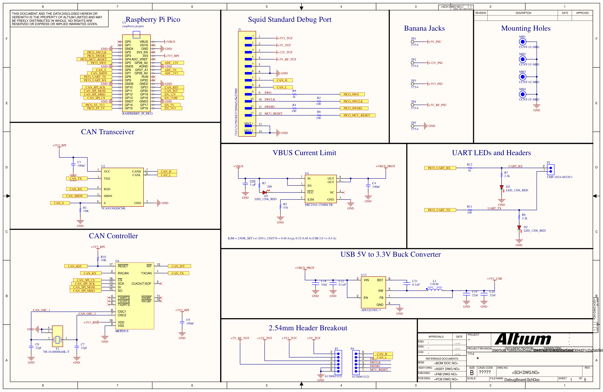

# Squid Debugger

Bench and flight debugger for **SquidSat**, SDSL's modular 3U CubeSat (ASU Sun Devil Satellite Laboratory).
It plugs into any SquidSat board through the **Squid Standard Debug Port** (J1, a 12-pin JST-GH) and gives a PC:

- **SWD**: flash and debug the board's MCU (SWCLK / SWDIO / SWO / reset).
- **CAN**: talk to, or sniff, the satellite's CAN bus (MCP2515 controller + TCAN330 transceiver).
- **UART**: a serial console (on header P2).
- **Bench power**: feed the board's four EPS rails (3.3 V, 5 V, 5 V RF, 12 V) from a lab supply or from USB.
  Every rail is switched, current-limited, over-voltage-protected and **OFF by default**.

A Raspberry Pi Pico (RP2040) is the brain: USB to the PC on one side, debug interfaces and power control on the other.

**Status: V1 schematic captured and verified** (5 sheets, 139 parts). PCB layout for V1 is not started yet;
the PCB file is still the V0 layout.

## Repository layout

| Path | What's in it |
|---|---|
| [`hardware/`](hardware) | The Altium Designer project. Open `Debugging Board V1.PrjPcb`. Sheets 1–5, PCB (V0 layout), BOM doc, OutJobs, libraries. |
| [`docs/`](docs) | **Start here.** How the board works and why it's designed this way. |
| [`design/`](design) | Design record: `V1_PLAN.md` (all math + datasheet review), `V1_CHANGELOG.md` (every change with reasons and alternatives), `V1_PARTS_LINKS.md`, block diagrams. |
| [`tools/`](tools) | Python tools that read, check and generate the Altium files (no Altium needed to run them). |
| [`reference/`](reference) | Team notes, the SquidSat SSC26 paper, the BOM spreadsheet, and links to all datasheets. |
| [`screenshots/`](screenshots) | V1 schematic images and PDF, V0 board and schematic captures, OBC Rev2 references. |

## Schematic (V1)

All five sheets as one PDF: [`screenshots/V1_schematic.pdf`](screenshots/V1_schematic.pdf) (Altium Smart PDF, Nov 27 2026).

| Sheet | Contents |
|---|---|
| [1 DebugBoard](screenshots/V1_sheet1_DebugBoard.png) | Pico, CAN controller + transceiver, debug port J1, banana jacks, VBUS limit, buck, UART, headers |
| [2 DebugBoardMuxes](screenshots/V1_sheet2_DebugBoardMuxes.png) | Bench inputs (TVS), AUX supply + 2.5 V reference, 5V RF and 12V switches |
| [3 DebugBoardPowerControl](screenshots/V1_sheet3_DebugBoardPowerControl.png) | Rail Enable (Pico GPIO + DIP force-on) and Rail Monitors (ADC dividers) |
| [4 DebugBoard3V3Mux](screenshots/V1_sheet4_DebugBoard3V3Mux.png) | 3V3 Power Mux (PSU vs USB) |
| [5 DebugBoard5VMux](screenshots/V1_sheet5_DebugBoard5VMux.png) | 5V Power Mux (PSU vs VBUS) |



## Documentation

1. [Overview](docs/01-overview.md): what the board does, its blocks, connectors and Pico pin map.
2. [Power architecture](docs/02-power-architecture.md): where power comes from, how the TPS2121 muxes work,
   enable logic, protection and the numbers behind them.
3. [Schematic guide](docs/03-schematic-guide.md): a sheet-by-sheet, part-by-part walkthrough.
4. [Firmware notes](docs/04-firmware-notes.md): what the Pico firmware must do (and must never do).
5. [Tools and workflow](docs/05-tools-workflow.md): how to check and regenerate the schematics, and the backups.
6. [Open items](docs/06-open-items.md): what is left before ordering boards.

## Quick start

- **Altium:** open `hardware/Debugging Board V1.PrjPcb` in Altium Designer 26.x. Sheets 2–5 use the
  local library `hardware/Libraries/SquidDebugger_V1/Project Outputs/SquidDebugger_V1.IntLib` (linked in the project)
  plus SDSL Altium 365 workspace parts.
- **Check the schematic without Altium** (Python 3 only):
  ```
  python tools/schnet.py hardware/DebugBoard.SchDoc          # netlist of a sheet
  python tools/verify_gen.py                                 # sheets 2–5 vs. the design spec
  python tools/verify_sheet1.py                              # sheet 1 vs. its source
  ```

## Team

Bjorn Bengtsson, Alex Jaber (V0 author). Sun Devil Satellite Laboratory, Arizona State University.
