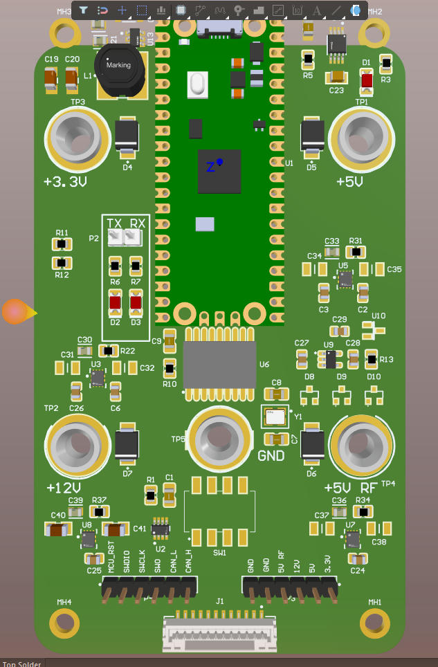
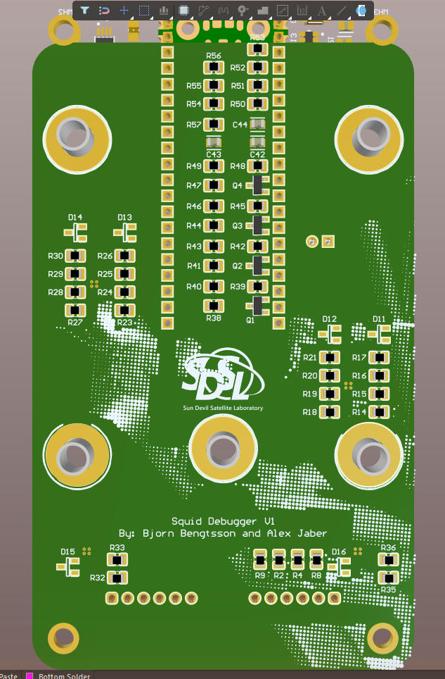
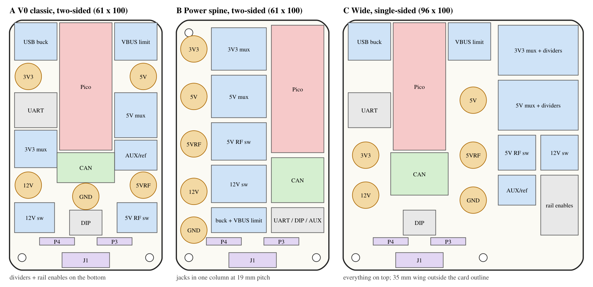

# V1 PCB layout: options, choice, stack-up, placement, review

Status (Nov 27 2026): **components placed, silkscreen done, DRC run. Not routed.** Routing waits for sign-off.

- Board file: `hardware/DebugBoard.PcbDoc` (the V0 layout is still in git history, commit `009cc9b` and earlier).
- The placement is generated. `tools/pcb_place.py` holds one table and writes `tools/altium/place_v1.pas`.
  Run it in Altium with **File » Run Script » SquidPcbTools.PrjScr » PlaceV1**. It places parts, positions every
  designator, moves the labels and clears artwork under pads. `StackV1` sets the layer stack. Neither routes anything.
- `DumpV1` writes the real pad and text geometry to `tools/altium/pcb_dump.txt`. `python tools/pcb_check.py`
  checks it: positions, spacing, designators, stack. `python tools/drc_summary.py` summarises Altium's DRC report.

| Top | Bottom (flipped view) |
|---|---|
|  |  |

**One side at a time:** run `ViewFront` (File » Run Script) to hide everything on the bottom side, `ViewBack` to hide
everything on the top side (then View » Flip Board), `ViewBoth` to show both again. They switch the copper, silk, paste,
mask and "Top …" / "Bottom …" mechanical layers. Through-hole pads stay visible on both sides.

Planning view with pads and designators, both sides: [`V1_placement.png`](V1_placement.png).

## 1. Constraints

| # | Constraint | Source |
|---|---|---|
| C1 | Outline **61 × 107 mm**, 5 mm corner radius (V0 was 61 × 100) | lengthened 7 mm on Nov 27 so the GND jack stays on the centre line |
| C2 | 4 × M3 holes (`CCNT-1U-MH1`), 5 mm in from each edge: **51 × 97 mm** pattern (V0: 51 × 90), pads on GND | same holes as V0; the top pair moved up with the edge |
| C3 | J1 (JST-GH 12) at the bottom edge centre, cable leaves the board | V0 |
| C4 | Pico USB connector at the top edge centre | V0 |
| C5 | Pico soldered flat: nothing on the top side under it; its pin rows are through-pads, so only the strip between them is free on the bottom | Pico footprint |
| C6 | Bottom side: 0805 / SOT-23 only (≤ 1.3 mm tall) so the board still sits on short standoffs | flight-stack spacing unknown, so stay low |
| C7 | Parts ≥ 0.5 mm from the edge, ≥ 0.25 mm between outline boxes | fab / assembly |
| C8 | Bench jacks, DIP switch SW1, headers and LEDs on the top side | usability |
| C9 | 4 layers, 1.6 mm, standard fab stack | cost |
| C10 | Every rail path sized for the TPS2121 limit, 1.65 A worst case | `design/V1_PLAN.md` |

Not confirmed: the SquidSat stack's card envelope. The paper only gives the payload bay (98.4 × 98.4 mm) and
M3 standoffs. **The board is now 7 mm longer than V0 and the hole pattern is 51 × 97 mm, so it no longer drops onto
V0's standoff positions. Check with Alex** whether the stack needs the 90 mm pattern.

## 2. Three options

(The sketches show the original 100 mm length. Option A was later lengthened to 107 mm, see section 5.)

- **A. V0 classic, two-sided.** Same arrangement as V0: Pico top centre, a jack in each quadrant, J1 at the bottom.
  Each rail's switch sits beside its jack. The small divider and enable parts go on the bottom.
- **B. Power spine, two-sided.** All five jacks in one column on the left at 19 mm pitch (dual banana plugs fit),
  the four switches in a column beside them, Pico on the right.
- **C. Wide, single-sided.** V0 arrangement plus a 35 mm wing on the right that holds all the power parts.

## 3. Weights and scores

Scores are 1 (poor) to 5 (good).

| Criterion | Weight | A | B | C | Why |
|---|---:|---:|---:|---:|---|
| Fits the card outline and holes (C1, C2) | 20 | 5 | 5 | 1 | C breaks the outline |
| Power integrity: jack → TVS → switch → caps → J1 short and wide | 20 | 4 | 5 | 4 | B has the shortest, most uniform paths |
| Signal integrity: CAN, crystal, SWD, buck kept apart | 15 | 4 | 3 | 4 | B squeezes CAN and puts the power column along the Pico's pins |
| Routable on two signal layers | 15 | 3 | 3 | 5 | A and B are dense |
| Assembly and probing (one side is easier) | 10 | 3 | 3 | 5 | |
| Bench use: jack access, labels, USB | 10 | 4 | 4 | 5 | |
| Thermal | 5 | 4 | 4 | 5 | all low power |
| Continuity with V0 (same look, known-good connector positions) | 5 | 5 | 2 | 3 | |
| **Weighted total (max 500)** | | **400** | **390** | **375** | |

**Choice: A.** B is close, but it gives up the V0 look and crowds the CAN and SWD side. C fails the outline constraint.

## 4. Stack-up: SIG / GND / GND / SIG (entered in the PcbDoc)

- Both signal layers sit 0.21 mm from a solid ground plane, so every trace has a tight return path.
- There are 8+ power nets. A power plane would have to be cut into islands and would be a poor reference.
  Rails are routed as wide traces or small pours on L1 / L4 instead.
- The two ground planes are stitched together. Put a GND via next to each signal via that changes sides.

| Layer | Use | Material | Thickness |
|---|---|---|---:|
| **L1 Top** | signals, power traces, parts | 1 oz copper | 0.035 mm |
| Prepreg | | 7628, εr 4.4 | 0.21 mm |
| **L2** | GND plane | 0.5 oz copper | 0.0175 mm |
| Core | | FR-4, εr 4.6 | 1.065 mm |
| **L3** | GND plane | 0.5 oz copper | 0.0175 mm |
| Prepreg | | 7628, εr 4.4 | 0.21 mm |
| **L4 Bottom** | signals, power traces, small parts | 1 oz copper | 0.035 mm |
| **Total** (plus solder mask) | | | **1.59 mm** |

This is the common low-cost 4-layer build (JLCPCB calls it JLC04161H-7628). Confirm against the fab you order from.
`pcb_check.py` reads these values back from the saved file.

### Routing rules that follow (not yet entered as Altium rules)

| Item | Value | Reason |
|---|---|---|
| Signal trace / clearance | 0.2 mm / 0.2 mm | standard fab limits with margin |
| Signal via | 0.3 mm drill, 0.6 mm pad | |
| Rail traces (`_PSU`, `_TGT`, `+VBUS*`, `+3V3_USB`) | ≥ 1.0 mm, pours where there is room | 1.65 A needs 0.6 mm for a 10 °C rise in 1 oz outer copper (IPC-2221) |
| Rail vias | 0.4 mm drill, 0.8 mm pad, at least 2 per layer change | ≈ 1 A per via, conservative |
| Neck-down at J1 pads (1.25 mm pitch) | 0.5 mm for ≤ 3 mm | pad width limits it |
| CAN_H / CAN_L | 0.2 mm traces, 0.25 mm gap, routed as a pair | ≈ 110–120 Ω differential; not critical at 1 Mbit/s |
| Crystal (Y1, C7, C8) | no traces or vias under it on L1 | keep the oscillator node quiet |

The V0 width rules in the file still name V0 nets (`+5V BNN`, …). Replace them with these before routing.

## 5. Placement

Positions come from Altium's real footprint geometry, not estimates. Every part keeps ≥ 0.25 mm to its neighbours.

| Zone | Where | Parts |
|---|---|---|
| Pico | top centre (as V0) | U1 |
| USB buck 5 V → 3.3 V | top left | U13, L1, C18–C22 |
| VBUS current limit | top right, at Pico pin 40 (VBUS) | U4, C4, C23, R3, R5, D1 |
| Bench jacks + TVS | four quadrants; each jack moved 3 mm outward so its TVS fits beside it | TP1–TP4, D4–D7 |
| GND jack | on the centre line, between SW1 and the CAN controller (as V0) | TP5 |
| UART | left of the Pico, inside V0's "TX RX" frame | P2, D2, D3, R6, R7; R11, R12 beside it |
| 3V3 mux | left, below UART; dividers underneath | U3, C6, C26, C30–C32, R22 / bottom: R14–R21, D11, D12 |
| 5V mux | right; dividers underneath | U5, C2, C3, C33–C35, R31 / bottom: R23–R30, D13, D14 |
| AUX supply + 2.5 V reference | right, above the 5 V RF jack | D8–D10, U9, U10, C27–C29, R13 |
| CAN controller + crystal | centre line under the Pico; crystal at its lower right; C9 / R10 at its left | U6, Y1, C7, C8, C9, R10 |
| CAN transceiver | left of the DIP switch | U2, C1, R1 |
| 12 V switch / 5 V RF switch | bottom left / bottom right | U8 …, U7 … (dividers and BAT54A underneath) |
| Force-on DIP switch | centre, top side | SW1 |
| SWD series resistors | bottom side, above P4 | R2, R4, R8, R9 |
| Rail enables + ADC dividers | bottom side, between the Pico's pin rows | Q1–Q4, R38–R57, C42–C44 |
| Connectors | bottom edge (as V0) | J1, P3, P4 |

Each TPS2121 sits at 0° with its parts arranged around its pinout: input bypass caps at the IN pins (lower
corners), output caps at the OUT pins (upper corners), soft-start cap and limit resistor at the top row.

**Why the board is 7 mm longer than V0:** the real SW1 (12.7 × 12.1 mm), GND jack (10.5 mm pad) and U6 (12.9 mm
square) need 37 mm in one column, and V0's 100 mm board leaves 35 mm under the Pico. To keep the GND jack on the
centre line as in V0, everything from the Pico upward moved up 7 mm (Pico, the two upper jacks, buck, VBUS limit, top
holes). The UART group stayed inside its V0 silk frame.

### Silkscreen

- All 139 designators: 0.8 mm tall, 0.15 mm stroke, next to their part (never more than 3 mm away).
- None is on a pad, hole or via, under the Pico, outside the board, or on another designator. `pcb_check.py` verifies this
  from Altium's own text boxes.
- Jack labels (+3.3V, +5V, +12V, +5V RF, GND) are 1.5 mm and sit below or beside their jack. "TX RX" is 1.3 mm inside its frame.
- V0 artwork on the bottom side is kept. Its halftone dots are removed only where a bottom-side pad or designator
  sits. The title now reads "Squid Debugger V1 / By: Bjorn Bengtsson and Alex Jaber" and sits above the SWD
  resistors, because bottom-side parts occupy its V0 position. The Clarke quote is removed.

## 6. DRC (Altium, Nov 27, unrouted board)

| Rule | Count | Verdict |
|---|---:|---|
| Un-routed net | 320 | expected: nothing is routed |
| Clearance, short circuit, component clearance, hole-to-hole, silk-to-mask, silk-to-silk, room | 0 | clean |
| Hole size, minimum annular ring | 0 | clean after enlarging the TPS2121 vias (below) |
| Net antennae | 16 | the TPS2121 footprint's own 16 vias; clears when they are connected |
| Minimum solder-mask sliver | 8 | between adjacent pins of U6 (SOIC-18); also present in V0 |

The last two rows are footprint matters, not placement:
- **TPS2121 vias** were 0.2 mm hole / 0.4 mm pad in the vendor footprint. They are now **0.25 mm / 0.52 mm** on the
  board (0.135 mm ring, 0.18 mm between the IN and OUT vias). This is set by the placement script on the four parts
  on the board, not in the library: *Update From PCB Libraries* would put the small vias back, so re-run `PlaceV1` after it.
- **U6 mask slivers:** the mask web between SOIC pins is 0.06 mm. Fabs normally open the mask across the row. Harmless,
  but the rule can be set to match the fab.

Found and fixed during this pass:
- 6 short circuits: two bottom-side resistors sat on TPS2121 through vias, and the footprint vias had no nets.
- GND jack pad overlapping SW1's pads; U6 pin 15 at 0.07 mm from the Pico's GP15 pad.
- C25 on the "MCU_RST" pin label; SW1 on the "CAN_H" label.
- A placement room the import created off the board (46 violations).

## 7. Review before routing

### Power distribution

- Each rail runs one way: jack → TVS (beside the jack) → input cap → TPS2121 → output caps → J1.
- **J1 pin 1 is on the right.** Pins 1–4 (+3V3, +5V, +12V, +5V RF) are the right half; SWD is the left half.
  So +5V_TGT and +5V_RF_TGT come straight down the right side. **+3V3_TGT and +12V_TGT start on the left and must
  cross** to J1's right half. Run both on the bottom layer in the free channel under SW1 (y ≈ 13–19 mm).
- Longest paths: +3V3_TGT ≈ 80 mm and +5V_TGT ≈ 75 mm. At 1.0 mm width in 1 oz copper that is about 40 mΩ, so about
  50 mV at 1.24 A. Use 1.5 mm or a pour for these two.
- +VBUS_PROT crosses from U4 (top right) to the buck (top left): bottom layer under the Pico's USB end, ≥ 0.8 mm.

### Thermal

| Part | Worst-case loss | Rise | Note |
|---|---:|---:|---|
| TPS2121 (each) | 1.24² A × 56 mΩ ≈ 86 mW | ≈ 5–8 °C | normal copper is enough |
| AP63203 buck | ≈ 0.25 W | ≈ 25–30 °C | input is capped at 0.4 A by U4; give its GND pin a pour with vias to L2 |
| MIC2544 | 0.4² A × 120 mΩ ≈ 19 mW | negligible | |

### Signal integrity

- **Crystal:** Y1 is directly under U6's OSC pins, with C7 / C8 on either side.
- **Buck:** U13, L1 and input cap C18 are within 4 mm, in the top-left corner, far from the ADC pins (right side).
- **ADC dividers** are on the bottom under the Pico, shielded from the top by two ground planes.
- **CAN:** U2 is left of SW1, close to P4's CAN pins and J1 pins 7/8. No termination is fitted (open item).
- **U6 decoupling** (C9) is on the bottom, directly under pin 18. Use a via at the pin.

### Still open

1. **Routing**, after sign-off. Enter the width / via rules from section 4 first.
2. SOIC mask-sliver rule for U6 (section 6): set it to the fab's value.
3. **L1 footprint** (`WE-PD2SR_7850`, a workspace part) has its origin about 1.9 m from its pads. The script places
   it by its outline. Fix the origin in the workspace library; it is not a local file.
4. **Q1–Q4 footprint** `SOT103P240X110-3N`: its PcbLib is now part of the project, so imports find it. The compiled
   `SquidDebugger_V1.IntLib` still lacks it; recompile the LibPkg when convenient.
5. Card envelope and hole pattern of the flight stack (now 61 × 107, holes 51 × 97): confirm with Alex.
