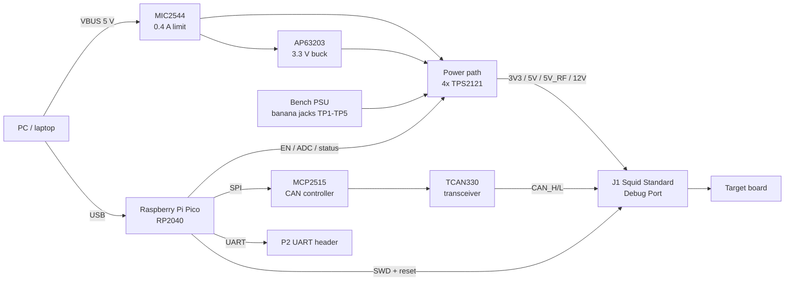

# 1. Overview

## What problem it solves

Every SquidSat board (OBC, EPS, payloads, …) has an MCU that needs flashing and debugging, and sits on a shared CAN
bus. On the bench there is no satellite stack around it, so the board also needs its supply rails from somewhere.
The Squid Debugger does all of this through **one cable**: the Squid Standard Debug Port.

## Block diagram

## The Squid Standard Debug Port (J1)

JST-GH 12-pin (BM12B-GHS-TBT), 1 A per contact. P3 (power) and P4 (signals) are 2.54 mm breakouts of the same pins.

| Pin | Net | Direction (debugger → target) |
|---|---|---|
| 1 | `+3V3_TGT` | power out |
| 2 | `+5V_TGT` | power out |
| 3 | `+12V_TGT` | power out |
| 4 | `+5V_RF_TGT` | power out |
| 5, 6, 13, 14 | GND | — |
| 7 / 8 | CAN_H / CAN_L | bus |
| 9 | SWO | in (from target) |
| 10 | SWCLK | out |
| 11 | SWDIO | bidirectional |
| 12 | MCU_RESET | out (open-drain style, see firmware notes) |

**Port rule: the power pins only ever *source* power to the target.** A target that also gets stack power must
OR the J1 rails in at its *lowest* priority, the way OBC Rev2 already muxes USB vs. EPS power. The debugger never
accepts power back. The earlier "v2" idea of feeding stack power in through J1 was dropped: the mux input and
output would become the same net and oscillate.

## The four rails

These match the SquidSat EPS rails (2S Li-ion → regulators):

| Rail | Sources on the debugger | Notes |
|---|---|---|
| 3.3 V | bench PSU (preferred), else USB via the buck | logic rail |
| 5 V | bench PSU (preferred), else USB VBUS | |
| 5 V RF | bench PSU only | low-noise LDO rail on the real EPS; USB is too noisy |
| 12 V | bench PSU only | boost rail on the real EPS; USB can't make it |

## Pico pin map (V1)

| GPIO | Function | GPIO | Function |
|---|---|---|---|
| GP0/1 | Pico console (free) | GP14 | `PICO_ST_3V3` (3V3 mux on PSU?) |
| GP2 | SWCLK (via R2 100 Ω) | GP15 | `PICO_ST_5V` (5V mux on PSU?) |
| GP3 | SWDIO (via R4 100 Ω) | GP16 | `EN_3V3` |
| GP4 | MCU_RESET (via R8 100 Ω) | GP17 | `EN_5V` |
| GP5 | SWO (via R9 1 kΩ) | GP18 | `EN_5VRF` |
| GP6 | CAN_S (silent) | GP19 | `EN_12V` |
| GP7 | CAN_SHDN | GP20 | CAN_INT |
| GP8 | UART_TX (via R11 100 Ω) | GP21 | CAN_RST |
| GP9 | UART_RX (via R12 1 kΩ) | GP22 | free |
| GP10–13 | CAN SPI: SCK, MOSI, MISO, CS | GP26/27/28 | `ADC_3V3` / `ADC_5V` / `ADC_12V` |

## Net naming convention

| Suffix | Meaning |
|---|---|
| `_PSU` | from the bench supply banana jacks, always live |
| `_USB`, `+VBUS_PROT` | from the laptop USB (`+VBUS_PROT` = after the MIC2544 current limit) |
| `_RPI` | the Pico's own 3.3 V output: debugger logic only, never goes to J1 |
| `_AUX` | always-on housekeeping supply (reference, pull-ups) |
| `_TGT` | switched rail going out on J1/P3 to the target, OFF by default |

## Sheets

| Sheet | File | Contents |
|---|---|---|
| 1 | `DebugBoard.SchDoc` | Pico, CAN transceiver + controller, USB current limit + buck, Debug Port, banana jacks, UART, headers |
| 2 | `DebugBoardMuxes.SchDoc` | Power Path: TVS, AUX supply + 2.5 V reference, 5V RF switch (U7), 12V switch (U8) |
| 3 | `DebugBoardPowerControl.SchDoc` | Rail enable (FETs + DIP), rail monitors (ADC dividers, mux status) |
| 4 | `DebugBoard3V3Mux.SchDoc` | 3V3 power mux U3 (PSU vs. USB → +3V3_TGT) |
| 5 | `DebugBoard5VMux.SchDoc` | 5V power mux U5 (PSU vs. VBUS → +5V_TGT) |

All five sheets are drawn in a **wired** style: real wires from the pins, parts hanging off the lines (caps under rails,
divider stacks rail → R → node → R → GND), power-port symbols for rails, ports only for signals that cross sheets,
and small net labels on internal nodes (OV1_x, PR1_x, ILM_x …) so each node can be probed by name.

Sheets connect by **net name** (project Net Identifier Scope = Global, ports name nets).
