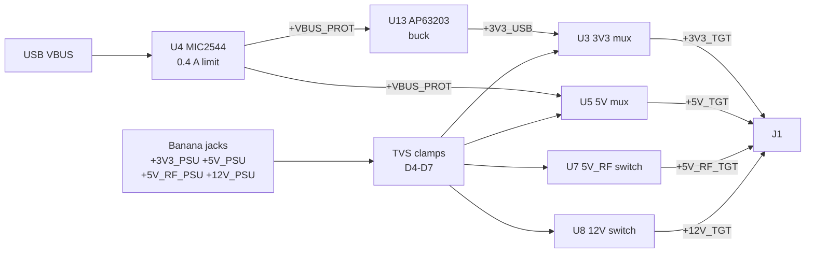
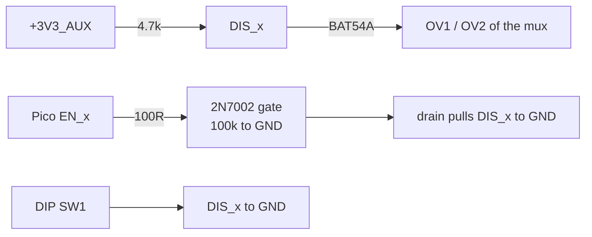

# 2. Power architecture

The goal is to power a target's four rails safely from whatever is on the bench (a lab supply, a laptop, or both)
without ever surprising the target.

## 2.1 Sources

- **Bench PSU (preferred):** four banana jacks TP1–TP4 plus GND (TP5). Full current, all four rails.
- **USB (fallback, 3.3 V and 5 V only):** the laptop's VBUS passes through **U4 MIC2544-1**, a current-limited switch
  set to 0.40 A by R5 = 576 Ω (I = 230 V / R). That keeps the total under USB 2.0's 500 mA, so the laptop never
  shuts the port off and resets the Pico. Its output `+VBUS_PROT` feeds the 5 V mux directly, and **U13 AP63203**
  bucks it down to `+3V3_USB` for the 3.3 V mux.
- **The Pico** runs from raw VBUS before U4. It is never a source for the target.

## 2.2 The TPS2121: one chip per rail

Each rail goes through a **TI TPS2121 power mux** (2.8–22 V, 56 mΩ, up to 4.5 A). One chip does five jobs:

| Job | Pin(s) | How it's used here |
|---|---|---|
| **Source priority** | PR1, CP2 | PR1 sees a divided-down copy of the PSU input. CP2 holds a precise 2.5 V reference (`XREF_2V5`). PR1 > CP2 → PSU (IN1) is used; PR1 < CP2 → switch to USB (IN2) in about 5 µs. |
| **Over-voltage cut-off** | OV1, OV2 | A divider per input. If an input goes above its limit, that channel turns off. |
| **Current limit** | ILM | 100 kΩ → about 1.24 A typical, so a shorted target can't burn the 1 A connector. |
| **Soft start** | SS | 100 nF → about 800 V/s ramp, so there's no inrush spike into the target. |
| **On/off** | OV1/OV2, driven by `DIS_x` | Forcing both OV pins high turns both inputs off, so the output is Hi-Z (TPS2121 truth table). That gives the per-rail switch. |
| **Reverse blocking** | internal | Back-to-back FETs: if the target is powered from elsewhere, nothing flows back into the debugger. |

The 3.3 V and 5 V rails are dual-input muxes (PSU over USB). The 5 V RF and 12 V rails are single-input: IN2, PR1,
CP2 and OV2 are tied to GND. Per TI, "if only one input is valid, that input powers the output", so the TPS2121 then
acts as a protected switch.

## 2.3 Switch-over thresholds (3.3 V and 5 V)

PR1 divider: R_T from the PSU input to PR1, R_B = 10.0 kΩ to GND, and hysteresis resistor R_H from PR1 to ST.
ST is high while IN1 is selected, and is pulled up 10 kΩ to `+3V3_AUX`.

- PSU falling: `V_fall = 2.5 + R_T·(2.5/R_B − 0.8/(R_H + 10k))`
- PSU rising: `V_rise = 2.5 + R_T·(2.5/R_B + 2.5/R_H)`

| Rail | R_T | R_H | Switches to USB below | Back to PSU above | Hysteresis |
|---|---|---|---|---|---|
| 3V3 (U3) | R14 = 2.10 k | R16 = 54.9 k | 3.00 V | 3.12 V | 122 mV |
| 5V (U5) | R23 = 8.25 k | R25 = 150 k | 4.52 V | 4.70 V | 179 mV |

During the 5 µs switch-over the 2× 22 µF output caps hold the rail up: droop = t·I/C = 5 µs × 1 A / 44 µF ≈ 114 mV.

**PR1 protection:** PR1's absolute maximum is 6 V. If someone plugs 12 V into the 3V3 jack, the divider would put
9.9 V on PR1. A 4.7 V zener (D11 / D13, BZX84-C4V7) clamps it. At the normal ≈2.7 V it doesn't conduct.

## 2.4 Over-voltage limits

OV divider: R_T from the input to OVx, 10.0 kΩ to GND. Trip voltage = VREF × (1 + R_T/10k), with VREF = 1.01 / 1.06 / 1.10 V
(min / typ / max).

| Rail | R_T | Trip, typ (min–max) |
|---|---|---|
| 3V3 | 26.1 k (R18, R20) | 3.83 V (3.65–3.97) |
| 5V, 5V RF | 44.2 k (R27, R29, R32) | 5.75 V (5.47–5.96) |
| 12V | 118 k (R35) | 13.6 V (12.9–14.1) |

## 2.5 On/off control (sheet 3)

- **Default = OFF.** `DIS_x` is pulled up to the always-on `+3V3_AUX`, and the BAT54A diode pulls both OV pins above
  VREF, so the mux output is off. That holds after power-up, during Pico reset, with the Pico unplugged, and with only
  the PSU connected. Worst case the OV node sits at 1.55 V, ≥ 0.45 V above VREF_max.
- **ON:** the Pico drives `EN_x` high → the 2N7002 pulls `DIS_x` low → the diode releases the OV pins, so the
  normal divider controls them again.
- **Manual ON:** DIP switch SW1 position n shorts `DIS_x` to GND. This is for PSU-only bench use without a laptop.
- The 100 kΩ gate pull-down keeps the FET off while the Pico pin floats.

## 2.6 Always-on AUX supply and reference

- **VAUX** = Schottky diode-OR (D8–D10, BAT54C) of every input: the four PSU rails plus VBUS. Whatever is present
  powers it.
- **U9 TLV70433** (24 V-in LDO) makes `+3V3_AUX` (≈3.9 mA total load, about 32 mW worst case from 12 V).
- **U10 LM4040-2.5 (B grade, ±0.2 %)** through R13 = 2.00 kΩ makes `XREF_2V5` (200–400 µA bias) for the CP2 pins.
  The precise reference is what makes the switch-over thresholds accurate.

## 2.7 Input protection and decoupling

- **TVS** on each banana input: D4–D6 SMBJ5.0A on 3V3/5V/5V RF and D7 SMBJ13A on 12V. These absorb hot-plug and ESD
  spikes. (SMBJ3.3A doesn't exist from a reputable maker; on 3V3, the SMBJ5.0A's ≥ 6.4 V breakdown is fine and the
  3.83 V OV cut-off still protects the target.)
- **Input caps:** one 1 µF X7R 0805 per TPS2121 input pin, drawn inside each mux box: C6/C26 (U3), C2/C3 (U5),
  C24 (U7), C25 (U8, 50 V part).
- **Output caps:** 2× 22 µF 1206 per rail, or 2× 10 µF 35 V on 12 V.

## 2.8 Telemetry to the Pico

| Signal | Source | Scaling |
|---|---|---|
| `ADC_3V3` (GP26) | `+3V3_TGT` via 49.9k / 100k | V_rail = V_adc × 1.499 |
| `ADC_5V` (GP27) | `+5V_TGT` via 100k / 100k | V_rail = V_adc × 2.0 |
| `ADC_12V` (GP28) | `+12V_TGT` via 470k / 100k | V_rail = V_adc × 5.7 |
| `PICO_ST_3V3/5V` (GP14/15) | mux ST pin via 100k | high = on PSU, low = on USB |

The divider and series resistors limit back-feed into an *unpowered* Pico to ≤ 71 µA (RP2040 pins are only safe to
IOVDD + 0.5 V).

All numbers are recomputed by `tools/calc_v1.py`; the datasheet cross-check is in `design/V1_PLAN.md` §8.
