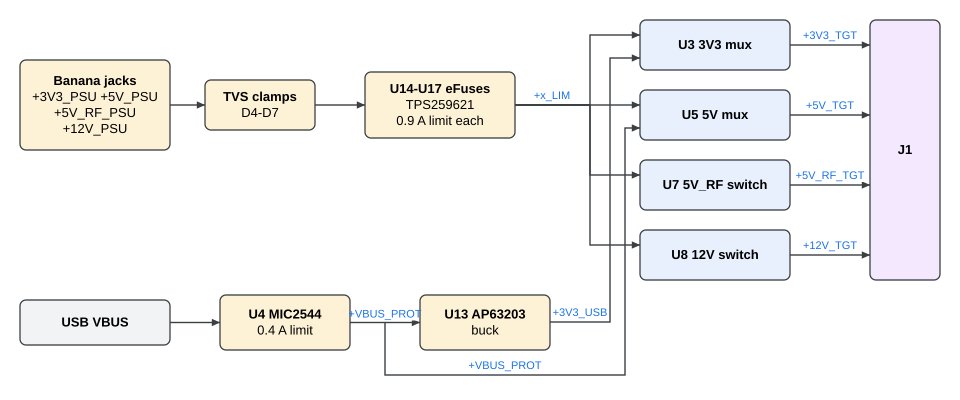
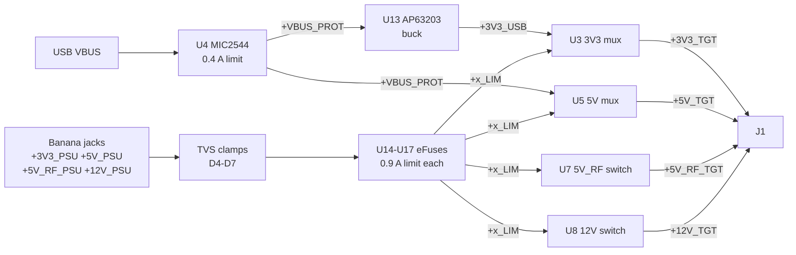
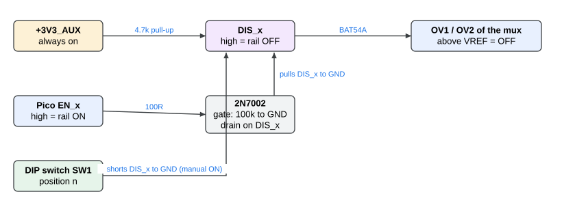
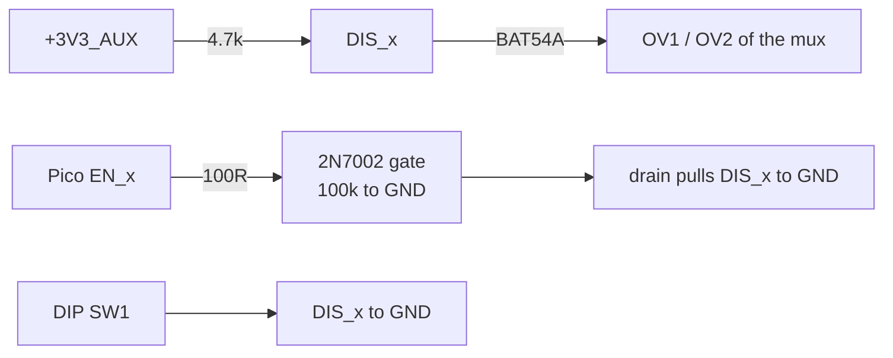

# 2. Power architecture

The goal is to power a target's four rails safely from whatever is on the bench (a lab supply, a laptop, or both)
without ever surprising the target.

## 2.1 Sources

Diagram source (Mermaid)

- **Bench PSU (preferred):** four banana jacks TP1–TP4 plus GND (TP5), all four rails. Each rail passes a TVS clamp
  and then its own **0.9 A eFuse** (section 2.9) before it reaches its TPS2121.
- **USB (fallback, 3.3 V and 5 V only):** the laptop's VBUS passes through **U4 MIC2544-1**, a current-limited switch
  set to 0.40 A by R5 = 576 Ω (I = 230 V / R). That keeps the total under USB 2.0's 500 mA, so the laptop never
  shuts the port off and resets the Pico. Its output `+VBUS_PROT` feeds the 5 V mux directly, and **U13 AP63203**
  bucks it down to `+3V3_USB` for the 3.3 V mux.
- **The Pico** runs from raw VBUS before U4. It is never a source for the target.

## 2.2 The TPS2121: one chip per rail

Each rail goes through a **TI TPS2121 power mux** (2.8–22 V, 56 mΩ, up to 4.5 A). One chip does five jobs:

| Job | Pin(s) | How it's used here |
|---|---|---|
| **Source priority** | PR1, CP2 | PR1 sees a divided-down copy of the PSU input. CP2 holds a precise 2.5 V reference (`XREF_2V5`). PR1 > CP2 → PSU (IN1) is used; PR1 < CP2 → switch to USB (IN2) in about 5 µs. |
| **Over-voltage cut-off** | OV1, OV2 | A divider per input. If an input goes above its limit, that channel turns off. |
| **Current limit (backstop)** | ILM | 100 kΩ → about 1.24 A typical (0.83–1.65 A). This is the chip's *lowest* setting and it can exceed J1's 1 A contact rating, so it is only a backstop. The real limit is the 0.9 A eFuse in front of each TPS2121 (section 2.9). |
| **Soft start** | SS | 100 nF → about 800 V/s ramp, so there's no inrush spike into the target. |
| **On/off** | OV1/OV2, driven by `DIS_x` | Forcing both OV pins high turns both inputs off, so the output is Hi-Z (TPS2121 truth table). That gives the per-rail switch. |
| **Reverse blocking** | internal | Back-to-back FETs: if the target is powered from elsewhere, nothing flows back into the debugger. |

IN1 of every TPS2121 is the limited net `+x_LIM` (the eFuse output). The PR1 and OV1 dividers still sense the jack side
(`+x_PSU`), so thresholds are unchanged by the limiter.

The 3.3 V and 5 V rails are dual-input muxes (PSU over USB). The 5 V RF and 12 V rails are single-input: IN2, PR1,
CP2 and OV2 are tied to GND. Per TI, "if only one input is valid, that input powers the output", so the TPS2121 then
acts as a protected switch.

## 2.3 Switch-over thresholds (3.3 V and 5 V)

PR1 divider: R_T from the PSU input to PR1, R_B = 10.0 kΩ to GND, and hysteresis resistor R_H from PR1 to ST.
ST is high while IN1 is selected, and is pulled up 10 kΩ to `+3V3_AUX`.

- PSU falling: `V_fall = 2.5 + R_T·(2.5/R_B − 0.8/(R_H + 10k))`
- PSU rising: `V_rise = 2.5 + R_T·(2.5/R_B + 2.5/R_H)`

| Rail | R_T | R_H | Switches to USB below | Back to PSU above | Hysteresis |
|---|---|---|---|---|---|
| 3V3 (U3) | R14 = 2.10 k | R16 = 54.9 k | 3.00 V | 3.12 V | 122 mV |
| 5V (U5) | R23 = 8.25 k | R25 = 150 k | 4.52 V | 4.70 V | 179 mV |

During the 5 µs switch-over the 2× 22 µF output caps hold the rail up: droop = t·I/C = 5 µs × 1 A / 44 µF ≈ 114 mV.

**With only a 3.3 V supply connected,** `+3V3_AUX` sits at about 2.9 V (3.3 V minus the Schottky and the LDO's
dropout). The pull-up term then shrinks and V_fall moves from 3.00 V to about 3.01 V. The 2.5 V reference still gets
its 200 µA. So the threshold is effectively independent of which inputs are present.

**PR1 protection:** PR1's absolute maximum is 6 V. If someone plugs 12 V into the 3V3 jack, the divider would put
9.9 V on PR1. A 4.7 V zener (D11 / D13, BZX84-C4V7) clamps it. At the normal ≈2.7 V it doesn't conduct.

## 2.4 Over-voltage limits

OV divider: R_T from the input to OVx, 10.0 kΩ to GND. Trip voltage = VREF × (1 + R_T/10k), with VREF = 1.01 / 1.06 / 1.10 V
(min / typ / max).

| Rail | R_T | Trip, typ (min–max) |
|---|---|---|
| 3V3 | 26.1 k (R18, R20) | 3.83 V (3.65–3.97) |
| 5V, 5V RF | 44.2 k (R27, R29, R32) | 5.75 V (5.47–5.96) |
| 12V | 118 k (R35) | 13.6 V (12.9–14.1) |

## 2.5 On/off control (sheet 3)

Diagram source (Mermaid)

- **Default = OFF.** `DIS_x` is pulled up to the always-on `+3V3_AUX`, and the BAT54A diode pulls both OV pins above
  VREF, so the mux output is off. That holds after power-up, during Pico reset, with the Pico unplugged, and with only
  the PSU connected. Worst case the OV node sits at 1.55 V, ≥ 0.45 V above VREF_max.
- **ON:** the Pico drives `EN_x` high → the 2N7002 pulls `DIS_x` low → the diode releases the OV pins, so the
  normal divider controls them again.
- **Manual ON:** DIP switch SW1 position n shorts `DIS_x` to GND. This is for PSU-only bench use without a laptop.
- The 100 kΩ gate pull-down keeps the FET off while the Pico pin floats.

## 2.6 Always-on AUX supply and reference

- **VAUX** = Schottky diode-OR (D8–D10, BAT54C) of every input: the four PSU rails plus VBUS. Whatever is present
  powers it.
- **U9 TLV70433** (24 V-in LDO) makes `+3V3_AUX` (≈3.9 mA total load, about 32 mW worst case from 12 V).
- **U10 LM4040-2.5 (B grade, ±0.2 %)** through R13 = 2.00 kΩ makes `XREF_2V5` (200–400 µA bias) for the CP2 pins.
  The precise reference is what makes the switch-over thresholds accurate.

## 2.7 Input protection and decoupling

- **TVS** on each banana input: D4–D6 SMBJ5.0A on 3V3 / 5V / 5V RF and D7 SMBJ13A on 12V. These absorb hot-plug and
  ESD spikes. Checked per diode against the part right behind it (the eFuse, 21 V absolute maximum):

  | Diode | Rail | Stand-off V_RWM | Breakdown V_BR | Clamp V_C at full pulse | Verdict |
  |---|---|---|---|---|---|
  | D4 SMBJ5.0A | 3V3 | 5.0 V | 6.40–7.00 V | 9.2 V | no leakage at 3.3 V; clamp far below 21 V. The eFuse then clamps its output at 3.8 V. |
  | D5, D6 SMBJ5.0A | 5V, 5V RF | 5.0 V | 6.40–7.00 V | 9.2 V | fine up to a 5.0 V supply (do not set the PSU above 5.0 V). eFuse output clamp 5.7 V. |
  | D7 SMBJ13A | 12V | 13.0 V | 14.4–15.9 V | 21.5 V | V_C is quoted at 27.9 A. A hot-plug spike is a few amps, where the clamp is ≈ 16–17 V: inside 21 V. The margin at full rated pulse is nil (open item: SMBJ12A clamps at 19.9 V). |

  (SMBJ3.3A doesn't exist from a reputable maker, which is why 3V3 uses the SMBJ5.0A.)
- **Input caps:** 100 nF at each eFuse input (C45–C48), and one 1 µF X7R 0805 per TPS2121 input pin, drawn inside
  each mux box: C6/C26 (U3), C2/C3 (U5), C24 (U7), C25 (U8, 50 V part). The IN1 cap is also the eFuse output cap.
- **Output caps:** 2× 22 µF 1206 per rail, or 2× 10 µF 35 V on 12 V.

## 2.8 Telemetry to the Pico

| Signal | Source | Scaling |
|---|---|---|
| `ADC_3V3` (GP26) | `+3V3_TGT` via 49.9k / 100k | V_rail = V_adc × 1.499 |
| `ADC_5V` (GP27) | `+5V_TGT` via 100k / 100k | V_rail = V_adc × 2.0 |
| `ADC_12V` (GP28) | `+12V_TGT` via 470k / 100k | V_rail = V_adc × 5.7 |
| `PICO_ST_3V3/5V` (GP14/15) | mux ST pin via 100k | high = on PSU, low = on USB |

### Back-feed into an unpowered Pico

The Pico is unpowered while the target is powered in two cases: the debugger runs from the bench PSU with no USB
cable (rails forced on by the DIP switch), or a stack-powered target is plugged in before the USB cable. RP2040 pins
are only rated to IOVDD + 0.5 V, so with IOVDD = 0 any high line pushes current through the pin's protection diode.
The series resistors set that current (worst case, 3.6 V or the rail's maximum on the far side):

| Line | Path into the Pico | Current | When |
|---|---|---|---|
| `ADC_3V3` / `ADC_5V` / `ADC_12V` | 49.9 k / 100 k / 470 k divider top | ≤ 71 / 50 / 27 µA | whenever the rail is up |
| `PICO_ST_3V3`, `PICO_ST_5V` | 10 k pull-up + 100 k | ≤ 30 µA | whenever AUX is up |
| SWO | 1 kΩ (R9) | ≈ 3 mA | target drives SWO high (push-pull output) |
| UART_RX | 1 kΩ (R12) | ≈ 3 mA | target's TX idles high |
| MCU_RESET | 100 Ω (R8) behind the target's ≈ 10 k pull-up | ≈ 0.3 mA | always |
| SWDIO | 100 Ω (R4) | ≈ 0.03–0.3 mA through the target's pull-up; **≈ 30 mA only if the target actively drives it high** | a target does not drive SWDIO without a debugger talking to it |
| SWCLK, UART_TX | 100 Ω | ≈ 0 | these are target inputs |
| CAN_H / CAN_L | via U2 TCAN330 | ≈ 0 | its bus pins are high-impedance when unpowered |

So the monitor lines are harmless (tens of µA). The lines that matter are **SWO and UART_RX at about 3 mA each**.
The RP2040 datasheet gives no injection-current rating, so 3 mA is "commonly tolerated", not guaranteed. The clean
fix is an Ioff-rated buffer on the signal lines (open item). Until then: plug in USB first.

## 2.9 PSU current limit (sheet 6)

**Why:** J1 contacts are rated 1 A. The TPS2121's own limit cannot be set below about 1.24 A typical (up to 1.65 A),
so a shorted target could overload a contact. Each bench rail therefore gets its own limiter in front of its TPS2121.

**Part:** TI **TPS259621DDAR** eFuse (2.7–19 V, 89 mΩ typical / 131 mΩ max, auto-retry, HSOIC-8 with thermal pad).
U14 = 3V3, U15 = 5V, U16 = 5V RF, U17 = 12V. Each takes `+x_PSU` in and gives `+x_LIM` out.

| Function | Pin | Value | Result |
|---|---|---|---|
| Current limit | ILM | R60 / R63 / R67 / R71 = 1.02 kΩ 1 % | I_LIM = 903 / R_ILM + 0.0112 = **0.90 A** typical; 0.83–0.97 A over part (±5.5 %) and resistor tolerance |
| Enable / under-voltage | EN/UVLO | 100 k / 100 k (3V3, 5V, 5V RF); 470 k / 100 k (12V) | threshold 1.20 V rising, 1.10 V falling → on above 2.40 V, off below 2.20 V (12V: 6.84 V / 6.27 V). The divider also keeps the pin under its 7 V maximum. |
| Output clamp select | OVCSEL | GND (3V3); 402 kΩ R64 / R68 (5V, 5V RF); open (12V) | output clamped at 3.8 V / 5.7 V / 13.8 V within 5 µs if the input goes high |
| Input bypass | IN | C45–C48 100 nF | |
| Soft start | dVdt | open | fastest ramp; the TPS2121's SS cap sets the rail's ramp |
| Fault flag | FLT | not connected | open item: wire-OR to Pico GP22 |

**What happens on a short:** the eFuse holds the current at 0.9 A. With the full supply across it, it heats up
(12 V × 0.9 A ≈ 11 W), shuts down at 157 °C and retries every 95 ms until the short is gone. The firmware sees this
as an enabled rail whose ADC reading is low.

**What it costs:** voltage drop. At 0.9 A the eFuse drops 0.9 × 0.089 = 80 mV and the TPS2121 another 50 mV, so
`+3V3_TGT` is about 0.13 V below the jack (up to 0.17 V hot). Set the bench supply 0.1 V high if the target needs it.
Loss in the eFuse is 72 mW at 0.9 A: no heat-sinking concern in normal use.

**Interaction with the mux:** the PR1 divider senses the jack side. If the eFuse is limiting, `+x_LIM` sags while
PR1 still says "PSU present". Once `+x_LIM` falls below the TPS2121's valid-input level, the 3V3 and 5V muxes fall
over to USB, which is itself limited to 0.4 A by U4. The target is current-limited either way.

**Not limited by the eFuses:** the AUX diode-OR and the dividers on `+x_PSU` (a few mA).

## 2.10 USB power budget

USB 2.0 allows 500 mA. The Pico (with the CAN chips, ≈ 50–100 mA) takes its share before U4.

| Budget | Value |
|---|---|
| U4 limit (R5 = 576 Ω) | 0.40 A typical, 0.32–0.48 A |
| Shared by | `+5V_TGT` directly **and** the 3.3 V buck's input |
| 5 V available to the target | 0.4 A minus the buck's input current |
| 3.3 V available to the target | P = 5 V × 0.4 A × 85 % ≈ 1.7 W → about **0.5 A** if the 5 V rail is unloaded |
| Worst case from the port | 0.48 A (U4 max) + ≈ 0.1 A (Pico) ≈ 0.58 A: **over 500 mA**. Most ports supply it; a strict port may shut off. |

Rule of thumb: on USB alone, keep the target under about 300 mA total at 5 V-equivalent. Anything heavier belongs on
the bench PSU. 5 V RF and 12 V are never available from USB.

All numbers are recomputed by `tools/calc_v1.py`; the datasheet cross-check is in `design/V1_PLAN.md` §8.
